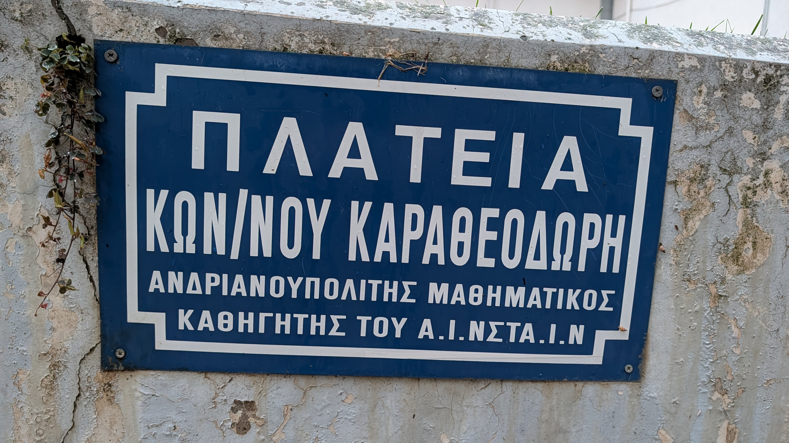
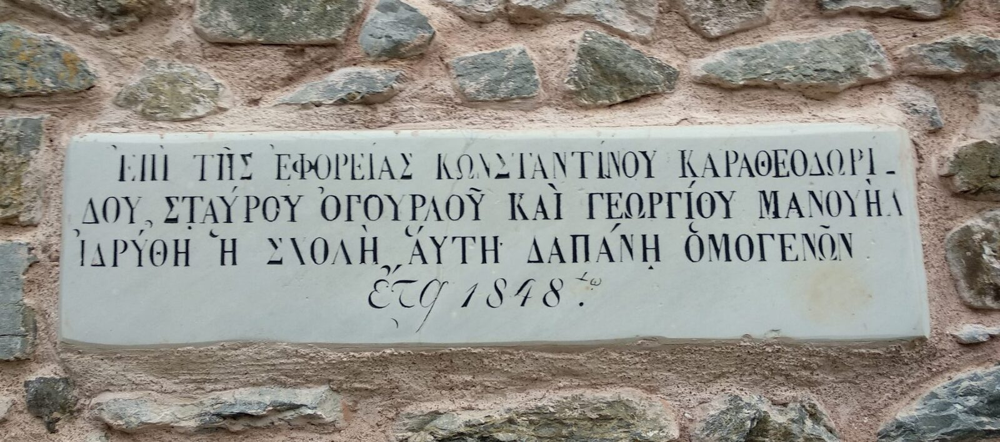

Μέσα του 2000. Μαθητής γυμνασίου τότε. Από το πουθενά και εντελώς ξαφνικά διασπείρεται μία φήμη που κατακλύζει την πόλη: ένας παγκοσμίου φήμης επιστήμονας, ένας μαθηματικός, και μάλιστα όχι όποιος κι όποιος αλλά ο...καθηγητής του Αϊνστάιν, ήταν Κομοτηναίος!!! Όλη η πόλη αρχίζει και συζητάει για το γεγονός αυτό και, μάλιστα, πολλοί αρχίζουν να παραδέχονται ότι όλο και κάπου, όλο και κάτι είχαν ακούσει και γνώριζαν, αλλά δεν ήταν και τόσο σίγουροι μέχρι τότε. Ώσπου στη συλλογική μνήμη της πόλης η φήμη για την καταγωγή του μετατρέπεται σε πληροφορία και η πληροφορία θεμελιώνεται σε γνώση που όλοι κάπως θολά γνώριζαν και απλώς τότε αναδύθηκε στην επιφάνεια.

Αφορμή για την αναπάντεχη συλλογική ανακάλυψη αποτέλεσε η τοποθέτηση του ανδριάντα του Κωνσταντίνου Καραθεοδωρή στην κεντρική πλατεία της Κομοτηνής κατά τη διάρκεια των Ελευθερίων του 2004. Ακολούθησε το αποκορύφωμα στην προσπάθεια οικειοποίησης της σπουδαίας αυτής οικουμενικής προσωπικότητας από την τοπική μας κοινωνία: η ίδρυση ενός μουσείου αφιερωμένο στη ζωή και το έργο του! Και κάπου εκεί άρχισαν να αντιδρούν περιοχές και άνθρωποι που θεωρούσαν δικαιωματικά ότι ο Καραθεοδωρή ανήκει περισσότερο σε εκείνους παρά σε εμάς. Γιατί, εντάξει ένα άγαλμα αλλά όχι και ολόκληρο μουσείο! 

Με αφετηρία το Βοσνοχώρι, το οποίο ονομάστηκε έτσι γιατί ο θρύλος λέει ότι σε εκείνη την περιοχή εγκατέστησαν οι Οθωμανοί αιχμάλωτους πολέμου από τη Βοσνία, έξω από την Αδριανούπολη στην Ανατολική Θράκη, η οικογένεια Καραθεοδωρή μετεγκαταστάθηκε στα μέσα του 19ου αιώνα στο Νεοχώρι του Βοσπόρου, προάστιο της Κωνσταντινούπολης. Μετά την υποχρεωτική ανταλλαγή των πληθυσμών, το 1923, οι πρόσφυγες από το Βοσνοχώρι εγκαταστάθηκαν στη Νέα Βύσσα, έξω από την Ορεστιάδα. Στον βόρειο Έβρο, λοιπόν, οι άνθρωποι θεωρούν ότι τους ανήκει η κληρονομιά της προσωπικότητας του μεγάλου μαθηματικού και αντέδρασαν στις ενέργειες της Κομοτηνής για την οικειοποίηση της. Οι δύο περιοχές, μάλιστα, η μία της καταγωγής και η άλλη της μετεγκατάστασης της οικογένειας, στο Νεοχώρι του Βοσπόρου, όπου μέχρι και σήμερα επιβιώνει η τοπική ελληνορθόδοξη κοινότητα, έχουν φτιάξει ισχυρούς δεσμούς φιλίας και αδελφοσύνης μεταξύ τους και διοργανώνουν φεστιβάλ προς τιμήν της οικογένειας των Καραθεοδωρίδων.

Γιατί, όμως, γίνεται αναφορά στην οικογένεια και όχι αποκλειστικά στον μαθηματικό; Διότι, στην πραγματικότητα, ο Κωνσταντίνος Καραθεοδωρή ήταν ένα από τα πολλά διακεκριμένα μέλη της οικογένειας. Ο πατέρας του, Στέφανος, υπήρξε διπλωμάτης της Οθωμανικής Αυτοκρατορίας και η διπλωματική του σταδιοδρομία ήταν μάλιστα ο λόγος που ο γιος του γεννήθηκε στο Βερολίνο, όπου εκείνη την περίοδο υπηρετούσε. Λίγο νωρίτερα, ένας άλλος Στέφανος, θείος του μαθηματικού, υπήρξε διακεκριμένος ιατρός και προσωπικός σύμβουλος των σουλτάνων, ενώ υπήρξαν κι άλλα διακεκριμένα μέλη. Στο προάστιο του Βοσπόρου όπου εγκαταστάθηκε, η οικογένεια ανέπτυξε έντονη κοινοτική δράση, με επίκεντρο την Παναγία Κουμαριώτισσα. Στον αύλειο χώρο του ναού βρίσκονται, μάλιστα, οι τάφοι ορισμένων μελών της.

*Εντοιχισμένη επιγραφή στην Παναγία Κουμαριώτισσα στην κοινότητα του Νεοχωρίου που βρίσκεται στην ευρωπαϊκή πλευρά του Βοσπόρου. Στην επιγραφή ξεχωρίζει το όνομα του παππού του μαθηματικού, του οποίου το όνομα αναγράφεται σε γενική πτώση ως Κωνσταντίνου Καραθεοδωρίδου*.   

Στην πραγματικότητα αν ψάξει κανείς να βρει γραπτά πειστήρια από τους εμπνευστές της κίνησης να συνδέσουν τον Καραθεοδωρή με την Κομοτηνή, δεν θα βρει. Επισήμως, δηλαδή, η Κομοτηνή δεν ανακήρυξε τον μαθηματικό ως τέκνο της. Η σύνδεση μέσω της φήμης που κυκλοφόρησε έγινε από στόμα σε στόμα. Για αυτό, αν κάποιος παρατηρήσει με προσοχή τον ανδριάντα στην πλατεία, θα διαπιστώσει ότι φέρει επάνω του όσα στοιχεία ανήκουν στη σφαίρα της πραγματικότητας. "Υπέροχο βλάστημα της θρακικής γης" και όχι "τέκνο της υπέροχης Κομοτηνής". Όπως επίσης, στο χέρι του κρατάει ένα βιβλίο με το σπουδαίο του έργο και τον τίτλο "λογισμοί μεταβολών" ή κάπως έτσι τέλος πάντων αλλά δεν ξέρω μαθηματικά οπότε δεν μπαίνω σε αυτά τα μονοπάτια γιατί αν το Χ ισούται με 2 εντάξει, αλλά αν το Χ ισούται με Ψ και ότι έστω το Κ = Λ τότε τι γίνεται; Τέλος πάντων... Υπάρχει, ωστόσο, μία πτυχή της ιστορίας που περιέχει, όπως κάθε καλός αστικός μύθος που σέβεται τον εαυτό του, έναν κόκκο αλήθειας: την πραγματική επικοινωνία του Καραθεοδωρή με τον Αϊνστάιν!

Δεν είναι εξάλλου άγνωστο το φαινόμενο σπουδαίες ιστορικές προσωπικότητες να επικοινωνούν μεταξύ τους. Από αυτοκράτορες, σουλτάνους και βασιλείς μέχρι ποιητές, συγγραφείς και, ασφαλώς, επιστήμονες, η ιστορία είναι γεμάτη από τέτοιες συναντήσεις και ανταλλαγές απόψεων, γνωμών και γνώσεων. Πολλές από αυτές, αν όχι οι περισσότερες, πραγματοποιούνταν μέσω επιστολών. Έτσι, και ανάμεσα στον Καραθεοδωρή και τον Αϊνστάιν αναπτύχθηκε μια επιστολική σχέση, μέσα από την οποία αντάλλασσαν σκέψεις, ερωτήματα και προβληματισμούς. Από την επικοινωνία, όμως, ανάμεσα στις δύο σπουδαίες μορφές της επιστήμης, μέχρι να θεωρηθεί ότι ο Καραθεοδωρή ήταν...καθηγητής του Αϊνστάιν υπάρχει μία απόσταση από την Κομοτηνή μέχρι τη Νέα Βύσσα για να μην πω μέχρι το Νεοχώρι στον Βόσπορο! Ακόμα κι αν ισχύει ότι ο Καραθεοδωρή βοήθησε τον Αϊνστάιν να προχωρήσει με τη *θεωρία της σχετικότητας* αυτό δεν τον καθιστά καθηγητή του αλλά έναν ουσιώδη συνομιλητή.

Από την άλλη πλευρά δεν είναι άγνωστο το φαινόμενο κοινωνίες μικρές και μίζερες, που νιώθουν μειονεκτικά απέναντι σε άλλες, να επιδεικνύουν συμπλεγματικές συμπεριφορές και να προσπαθούν να πατήσουν πάνω στα επιτεύγματα άλλων για να διογκωθούν, να μεγαλώσουν, να ψηλώσουν και να νιώσουν μία τεθλασμένη υπερηφάνεια. Ίσως, για αυτό εκείνη την άνοιξη να ξεκίνησε το ταξίδι της εκείνη η φήμη που προσπάθησε να...εκ-Κομοτηνίσει τον σπουδαίο Έλληνα μαθηματικό, ο οποίος το πιθανότερο είναι να μην πάτησε ποτέ το πόδι του στην Κομοτηνή, για να μην πω κιόλας καθ' υπερβολήν ότι μπορεί να μην την είχε ποτέ ακούσει! Σαν ένας σπόρος που φυτεύτηκε στη συλλογική μνήμη της πόλης, όπως "φυτεύονταν" οι πληροφορίες στο κεφάλι των ανθρώπων - στόχων στην ταινία Inception κατά τη διάρκεια των ονείρων τους. Ένα...όνειρο κι αυτό! Ο δάσκαλος του Αϊνστάιν είναι Κομοτηναίος! Ποιος ξέρει; Ίσως, τελικά ο Καραθεοδωρή να ήταν καθηγητής του Ανωτάτου Ιδρύματος Νσταθηματικών Ιδιαίτερης Νοημοσύνης - Α.Ι.ΝΣΤΑ.Ι.Ν, που λέει και η πινακίδα με το οδωνύμιο! 

ΥΓ1: Ο οικουμενικός Έλληνας μαθηματικός Κωνσταντίνος Καραθεοδωρή συνδέεται με μία από τις τραγικότερες στιγμές της ιστορίας του Ελληνισμού: τη Μικρασιατική Καταστροφή. Ο Ελευθέριος Βενιζέλος τού ανέθεσε την πλήρη οργάνωση του υπό ίδρυση Ιωνικού Πανεπιστημίου στη Σμύρνη, πρόταση την οποία ο ίδιος αποδέχθηκε. Με προσωπική φροντίδα μερίμνησε για τη στελέχωση, τον εξοπλισμό και τον εμπλουτισμό της βιβλιοθήκης του ιδρύματος, το οποίο προοριζόταν να ξεκινήσει τη λειτουργία του το φθινόπωρο του 1922. Η κατάρρευση του μικρασιατικού μετώπου ανέτρεψε οριστικά αυτόν τον σχεδιασμό. Ο Καραθεοδωρή, ωστόσο, κατάφερε να διασώσει σημαντικό μέρος του εξοπλισμού και της βιβλιοθήκης, αποστέλλοντάς τα στην Αθήνα. Τα αντικείμενα αυτά σώζονται μέχρι σήμερα στο Μουσείο Φυσικών Επιστημών και Τεχνολογίας του Εθνικού και Καποδιστριακού Πανεπιστημίου Αθηνών. Το Ιωνικό πανεπιστήμιο δεν λειτούργησε ποτέ. Ο ίδιος ο Καραθεοδωρή έμεινε μέχρι τελευταία στιγμή και έφυγε από τη Σμύρνη μία μέρα πριν μπουν οι Τούρκοι και στη συνέχεια κάψουν την πόλη.

ΥΓ2: Ναι, αλλά γιατί χωρίς τελικό σίγμα; Ο μαθηματικός, όπως αναφέρθηκε και παραπάνω, γεννήθηκε στο Βερολίνο. Στη συνέχεια εγκαταστάθηκε με την οικογένειά του στις Βρυξέλλες, όπου και φοίτησε. Το Βέλγιο είναι (και) γαλλόφωνο. Στην ενήλικη ζωή του υπέγραφε ως *Constantin Carathéodory*, προσαρμόζοντας τη γραφή του ονόματός του στις διεθνείς συνθήκες. Είναι πιθανό αυτή η γραφή να επηρέασε και την καθιέρωση του επωνύμου του στα ελληνικά, διατηρώντας το χωρίς τελικό σίγμα. Μία αναλογία μπορούμε να πούμε πως είναι η χρήση της ονομαστικής πτώσης στα επώνυμα των Ελληνοαμερικανών, καθώς στα αγγλικά δεν υπάρχει η γενική. Η Nia Vardalos, για παράδειγμα, αποκαλείται...Νία Βαρντάλος και όχι Βαρδάλου όπως είναι το οικογενειακό της επώνυμο στα ελληνικά.