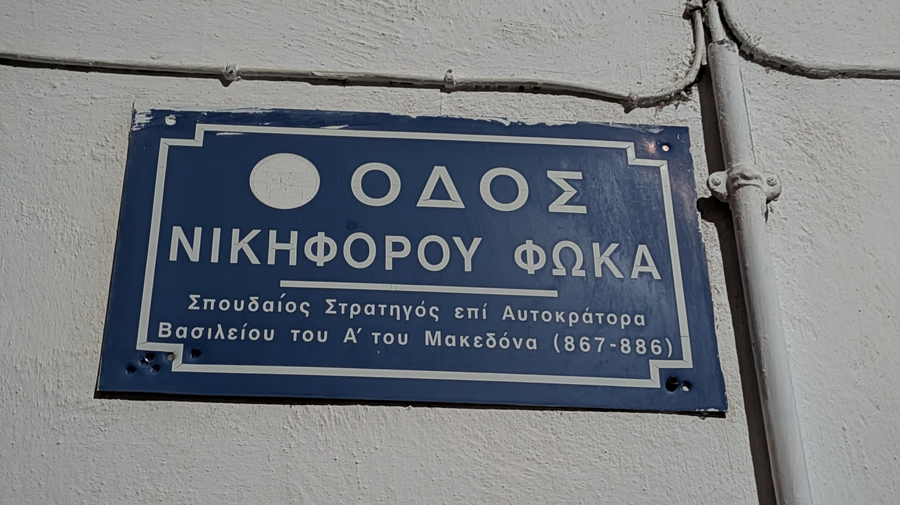

Εντάξει, καταλαβαίνω. Δεν υπήρχαν κάποτε οι 352 μηχανές αναζήτησης, τα εργαλεία τεχνητής νοημοσύνης και η ευκολία πρόσβασης στο διαδίκτυο που έχουμε σήμερα. Αλλά όχι και να χαρακτηρίζουμε απλώς ως έναν  *σπουδαίο στρατηγό* του Βασιλείου Α' τον Νικηφόρο Φωκά, έναν από τους επιφανέστερους αυτοκράτορες της Βυζαντινής Αυτοκρατορίας! Να τα πάμε, όμως, λίγο από την αρχή τα πράγματα γιατί εδώ πέρα παίχτηκε η φάση: πετάξαμε πέτρα στη θάλασσα και δεν βρήκαμε νερό!  

Ο Βασίλειος Α΄ υπήρξε ένας από τους σημαντικούς αυτοκράτορες του Βυζαντίου και ιδρυτής της *Μακεδονικής δυναστείας*, της μακροβιότερης και σημαντικότερης δυναστείας που κυβέρνησε την αυτοκρατορία. Ανήλθε στον αυτοκρατορικό θρόνο το 867 μ.Χ., μόλις 24 χρόνια μετά την αναστήλωση των εικόνων (843 μ.Χ.), ένα σχετικά σύντομο χρονικό διάστημα στην ιστορική κλίμακα της εποχής. Η άνοδός του στην εξουσία ήρθε σε μια περίοδο κατά την οποία η αυτοκρατορία είχε μόλις αφήσει πίσω της την Εικονομαχία, μια μακρά περίοδο θρησκευτικών και πολιτικών συγκρούσεων που είχε κλονίσει τα θεμέλιά της και είχε συνοδευτεί από διαδοχικές ανατροπές στην εξουσία, εξωτερικές απειλές και έντονη πολιτική αστάθεια. 

Ανασυγκρότησε το κράτος, αντιμετώπισε τις εξωτερικές απειλές και επανέφερε την τάξη στο εσωτερικό και το 886 μ.Χ. έκανε αυτό που θα κάνουμε όλοι. Πέθανε. Και περίπου 30 χρόνια μετά γεννήθηκε ο Νικηφόρος Φωκάς! Συγκεκριμένα το 912 μ.Χ. Οπότε, τώρα προκύπτει μία καταφανής δυσκολία. Φαντάζομαι δηλαδή ότι τη διακρίνετε και εσείς: Πώς ακριβώς διετέλεσε στρατηγός του Βασιλείου Α', ο Νικηφόρος Φωκάς, όταν δεν έτυχε ρε παιδί μου να συνυπάρξουν ούτε μία μέρα στον μάταιο τούτο κόσμο;   

Ας έρθουμε τώρα λίγο στα δικά μας... Για τη συγκεκριμένη πινακίδα έκανα κάτι που δεν θέλω να κάνω για αυτά τα κείμενα, τα οποία συνήθως έχω ήδη σχηματίσει μέσα στο κεφάλι μου κατά τη διάρκεια μιας βόλτας, όταν εντοπίζω μία τέτοια ομορφιά. Προχώρησα δηλαδή σε μία σύντομη έρευνα. Ανακάλυψα, λοιπόν, ότι αυτές οι πινακίδες πηγαίνουν πίσω περίπου 3 δεκαετίες. 30 χρόνια πριν... Και τότε, όπως είπαμε, δεν είχαν ούτε google search, ούτε ΑΙ, ούτε την Alexa να ρωτήσουν για να μάθουν. Είχαν όμως εγκυκλοπαίδειες! 

Κάθε σπίτι και εγκυκλοπαίδεια! Ήταν ένα *must*, που λένε και στο Ίασιο της Ροδόπης (μην μπερδευτείτε με το Ιάσιο της Ρουμανίας. Εκεί δεν ξέρω αν το λένε!)! Και παρόλο που κόστιζαν αρκετά ήταν η περίοδος τέτοια ώστε κάθε νοικοκυριό έφτασε στο σημείο να διαθέτει από μία εγκυκλοπαίδεια! Υπήρχαν, μάλιστα, εκδοτικοί οίκοι που ενημέρωναν κάθε χρόνο τις σειρές τους με αποτέλεσμα οι εγκυκλοπαίδειες να αποτελούν ένα από τα βασικά εργαλεία γνώσης για κάθε σπίτι. Θυμάμαι πολύ έντονα, στα μαθητικά μου χρόνια, να γίνονται απαραίτητο εργαλείο για τις εργασίες που μας ανέθεταν οι καθηγητές στο σχολείο! "Εγκυκλοπαίδεια έχετε σπίτι; Ωραία, ψάξε στο λήμμα τάδε για την εργασία σου"! Είχαν γίνει τόσο απαραίτητες που υπήρχαν πλανόδιοι πωλητές που πήγαιναν από σπίτι σε σπίτι για να βρουν κάποιον ενδιαφερόμενο αγοραστή! Υπάρχει, μάλιστα, επεισόδιο στη σειρά *Τα Φιλαράκια*, στο οποίο ένας πλανόδιος πωλητής που πουλάει εγκυκλοπαίδειες εμφανίζεται στην πόρτα του Τζόι και τον πείθει να αγοράσει έναν τόμο! Δηλαδή, ολόκληρη τη σειρά ήθελε να του πουλήσει αλλά ο Τζόι, όντας Τζόι, είχε πάνω του χρήματα μόλις για έναν τόμο... Τέλος πάντων, το πιάσατε το νόημα, θαρρώ! Ήταν η εποχή της εγκυκλοπαίδειας! 

Μια εγκυκλοπαίδεια, ρε παιδιά, να άνοιγε ένας άνθρωπος στην αρμόδια υπηρεσία οδοσήμανσης, θα είχε αποφευχθεί αυτή η αστοχία! Ας δώσουμε, όμως, και ένα ελαφρύ ελαφρυντικό! Ο Νικηφόρος Φωκάς, προτού αναρρηθεί στον θρόνο (963-969 μ.Χ.) ή, μάλλον, για το ιστορικά ακριβές, προτού τον... αναρρήσει (επιτηδευμένο λάθος στο πλαίσιο της ποιητικής αηδίας) στον θρόνο το στράτευμα, ήταν... στρατηγός! Ένας πολύ πετυχημένος και ιδιαίτερα αγαπητός στο στράτευμα της αυτοκρατορίας στρατηγός! Είναι πολύ πιθανό, μάλιστα, να έμενε στην ιστορία ως ένας από τους κορυφαίους στρατηγούς της Βυζαντινής Αυτοκρατορίας, όπως συνέβη με τον Ναρσή και τον Βελισάριο επί Ιουστινιανού, ακόμη κι αν δεν αναρριχόταν ποτέ στον θρόνο, αφού τα μεγαλύτερα επιτεύγματά του τα πέτυχε ως αρχηγός του στρατού. Συγκεκριμένα, διακρίθηκε για τις πετυχημένες εκστρατείες του εναντίον των Αράβων, τόσο στα εδάφη της Συρίας όσο και, κυρίως, για την ανακατάληψη της Κρήτης (961 μ.Χ.).

Τώρα που το σκέφτομαι, δηλαδή, αν ρωτούσαν, ίσως, σε ένα σχολείο κάποιον ιστορικό, πραγματικό ιστορικό όμως, όχι από αυτούς που διδάσκουν γαλλικά, ή κάποιον φιλόλογο που τα χρόνια εκείνα ήταν πραγματικοί φιλόλογοι και δεν έψαχναν να βρουν αν το "μήνυμα" γράφεται με "ήτα" - "ύψιλον" ή με "ύψιλον" - "ήτα", οι οποίοι, για να αποκτήσουν το πτυχίο τους, έπρεπε να μελετήσουν και την ιστορική περίοδο στην οποία εντάσσεται και εξελίσσεται η γλώσσα που αποτέλεσε το αντικείμενο των σπουδών τους, θα λάμβαναν πιθανότατα και τη διασταύρωση της πληροφορίας για το τι ήτο ο Νικηφόρος Φωκάς!   

ΥΓ: "Η ιστορία υπάρχει για να κάνει τη γεωγραφία μπουρδέλο", Ελένη Γλύκατζη - Αρβελέρ. Ο Βασίλειος Α΄ ήταν αρμενικής καταγωγής και γεννήθηκε στην περιοχή της Αδριανούπολης, ίσως μάλιστα μέσα στην ίδια την πόλη. Για την αποτελεσματικότερη άμυνα της αυτοκρατορίας, οι Βυζαντινοί είχαν διαμορφώσει ένα σύστημα στρατιωτικής διοίκησης, γνωστό ως σύστημα των Θεμάτων. Την εποχή της γέννησης του Βασιλείου, η Αδριανούπολη, παρόλο που γεωγραφικά ανήκει στη Θράκη, διοικητικά υπαγόταν στο *Θέμα Μακεδονίας*. Έτσι, ο Βασίλειος είχε την εξής ιδιαίτεροτητα: ήταν αρμενικής καταγωγής, γέννημα Θράκης και ιδρυτής της *Μακεδονικής δυναστείας*! 

ΥΓ1: Μπορεί ο Νικηφόρος Φωκάς να μην είχε καμία σχέση με τον Βασίλειο Α΄, έμελλε ωστόσο να συνδεθεί με τον Βασίλειο Β΄. Κι αυτό γιατί είχε την κακή τύχη να βρεθεί στον δρόμο της Θεοφανώς, μητέρας του τελευταίου και μίας από τις μεγαλύτερες μέγαιρες της παγκόσμιας ιστορίας. Η Θεοφανώ ερωτοτροπούσε, παντρευόταν και ξεφορτωνόταν τους συζύγους της με μεγαλύτερη συχνότητα απ' ό,τι άλλαζε τα πολυτελή μεταξωτά της ενδύματα. Μπροστά στα έργα και τις ημέρες της, ακόμη και η μυθοπλασία του Game of Thrones μοιάζει με παραμύθι για μικρά παιδιά. Ανάμεσα στα θύματά της βρέθηκε και ο ίδιος ο Νικηφόρος Φωκάς, τον οποίο δολοφόνησε ο νέος εραστής της, Ιωάννης Τσιμισκής, την ώρα που κοιμόταν για να πάρει στη συνέχεια τη θέση του στον αυτοκρατορικό θώκο. 