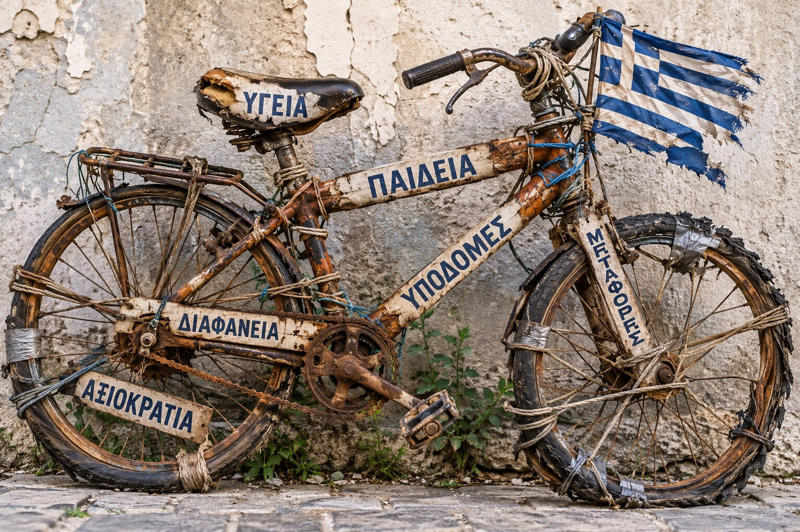

Στα χρόνια του γυμνασίου (μέσα του 2000) μάς είχε πιάσει μια τρέλα με τα ποδήλατα. Επηρεασμένοι από τους μεγαλύτερους σε ηλικία αδερφούς, φίλους και γείτονες που είχαν αρχίσει να ψάχνονται για καλύτερα, πιο ποιοτικά και πιο ακριβά μοντέλα, πέσαμε και οι μικρότεροι με τα μούτρα: ποιες είναι οι καλύτερες εταιρείες, ποιο υλικό κατασκευής είναι προτιμότερο για μεγάλες αποστάσεις, ποιο για ανώμαλο δρόμο κοκ. Κάπως έτσι είχαμε κάνει στέκι τις *Διαδρομές* του Νίκου απέναντι από την Τσανάκλειο - ένα κατάστημα ναός του ποδηλάτου!

Κάποια μέρα ένας γείτονας, ο οποίος είχε παρατηρήσει το πνεύμα της εποχής που μας χαρακτήριζε, με φώναξε και μου έδειξε ένα ποδήλατο στην αυλή του που ήταν εκτεθειμένο για πολύ καιρό στις καιρικές συνθήκες· στις βροχές, την υγρασία κλπ και ως εκ τούτου σε κακή κατάσταση και μου ζήτησε να το πάρω και να το πάω στον μάστορα που πηγαίναμε τα δικά μας με σκοπό να το φτιάξει και θα περνούσε εκ των υστέρων ο ίδιος για να πληρώσει την επισκευή και να παραλάβει το ποδήλατο. Έτσι, λοιπόν, πήρα το ποδήλατο και το πήγα στο Νίκο.

Λίγες μέρες αργότερα πέρασα από το κατάστημα και θυμάμαι ακόμα το επιτιμητικό βλέμμα που μου ΄ριξε ο μάστορας όταν παρατήρησε την παρουσία μου: *Καλά ρε... τι ήταν αυτό που μου έφερες τις προάλλες; Έπιανα να φτιάξω την αλυσίδα, χαλούσαν οι ταχύτητες. Έπιανα να φτιάξω τις ταχύτητες, χαλούσε το φρένο. Έπιανα να φτιάξω το φρένο, χαλούσε το τιμόνι. Έπιανα να φτιάξω το τιμόνι, χαλούσαν οι ακτίνες... Για πέταμα ήταν εκείνο το πράγμα. Καλύτερα να έπαιρνε ένα καινούργιο.*

Στα μετέπειτα χρόνια, κάθε φορά που θυμάμαι εκείνο το σκηνικό, δεν μου έρχεται καλύτερη παρομοίωση για τις συνθήκες που επικρατούν στην Ελλάδα. Δεν μπορώ να σκεφτώ έναν τομέα του κράτους και της κοινωνίας μας που να λειτουργεί σωστά. Από την υγεία και την παιδεία που πλέον μόνο καταχρηστικά συνοδεύονται από τη λέξη *δημόσια*, τις μεταφορές που είναι πανάκριβες λόγω καυσίμων και διοδίων, τις υποδομές που είναι ανύπαρκτες και έχουν γίνει τοπικά ανέκδοτα (μέχρι πρότινος το *μετρό Θεσσαλονίκης* θεωρούνταν ένα τραγικό αστείο, ενώ στα δικά μας μέρη, στη Ροδόπη, υπάρχει ένα αντίστοιχο για το φράγμα του Ιάσμου που όπως λένε οι μεγαλύτεροι έχει μπει στα πρώτα - άντα/το αστείο, αφού φράγμα δεν υπάρχει), την ενέργεια, τη γεωργία, τη βιομηχανική παραγωγή και, φυσικά, η παντελής απουσία διαφάνειας και αξιοκρατίας από κάθε πτυχή της δημόσιας ζωής. Στην πραγματικότητα τίποτα δεν λειτουργεί σωστά μέχρις ότου κάτι να συμβεί σε κάποιον από αυτούς τους τομείς, να γίνει πρώτο θέμα στην επικαιρότητα της χώρας και να το παίξουμε όλοι ανήξεροι πως τάχα κανείς δεν γνώριζε ότι ο συγκεκριμένος τομέας είχε προ πολλού σαπίσει.

  
Κι αν τα βάλει κανείς κάτω και αρχίσει να εξετάζει κάθε τομέα ξεχωριστά, αναζητώντας τι πρέπει να αλλάξει για να βελτιωθεί η κατάσταση, πολύ εύκολα διαπιστώνει πως τα πράγματα περιπλέκονται. Για να γίνει κάτι στον Χ τομέα, πρέπει πρώτα να διορθωθούν οι παθογένειες του Ψ, καθώς οι δύο τομείς είναι αλληλένδετοι και η λειτουργία του πρώτου εξαρτάται, σε κάποιον βαθμό, από τη λειτουργία του δεύτερου. Στη συνέχεια, όμως, γίνεται αντιληπτό πως για να βελτιωθεί ο Ψ πρέπει προηγουμένως να αλλάξει κάτι σε έναν τρίτο τομέα, από τον οποίο επίσης εξαρτάται. Και κάπως έτσι, ακολουθώντας αυτή την αλυσίδα, καταλήγει κανείς να διαπιστώνει πως για να διορθωθεί ο ένας τομέας πρέπει πρώτα να διορθωθεί κάποιος άλλος, ο οποίος με τη σειρά του εξαρτάται από έναν τρίτο, και ούτω καθεξής. Με τη μεγάλη εικόνα να αποκαλύπτει πως χρειάζεται να αλλάξουν σχεδόν όλα, αφού στην πραγματικότητα τίποτα δεν λειτουργεί όπως θα έπρεπε, όπως προβάλλεται, διαφημίζεται κλπ (σαν τις διαφημίσεις των τροφίμων που λάμπουν και ξεχειλίζουν φρεσκάδα αλλά μόλις ανοίξουμε τη συσκευασία είναι σαν να πήραμε άλλο προϊόν) και τα πάντα πορεύονται στον αυτόματο πιλότο μέσα από την αναπαραγωγή μιας προβληματικής τυχαιότητας.

Ας πούμε, για παράδειγμα, ότι θέλουμε να αλλάξουμε ριζικά τους τομείς της εκπαίδευσης και της υγείας που είναι ζωτικοί για τη λειτουργία και το μέλλον μιας κοινωνίας και παρουσιάζουν παρόμοια προβλήματα, τα οποία λίγο - πολύ είναι: παλιά και επικίνδυνα κτήρια, γεμάτα φθορές, στεγάζουν σχολεία και νοσοκομεία, οι υπηρεσίες είναι υποστελεχωμένες και το προσωπικό κακοπληρωμένο. Ειδικά στον τομέα της εκπαίδευσης, υπάρχουν χιλιάδες κενά και χάνονται εκατοντάδες διδακτικές ώρες κάθε χρόνο. Πολλά νοσοκομεία δεν διαθέτουν καν τον απαραίτητο εξοπλισμό, ενώ το προσωπικό εξουθενώνεται από τις εξαντλητικές εφημερίες, καθώς δεν γίνονται οι απαραίτητες προσλήψεις για να καλυφθούν οι ανάγκες. Τα μεγάλα νοσοκομεία που καλύπτουν τις πραγματικές έκτακτες ανάγκες έχουν συγκεντρωθεί στα μεγάλα αστικά κέντρα, ενώ τα σχολεία στην ύπαιθρο κλείνουν το ένα μετά το άλλο και σε πολλές περιπτώσεις υπάρχει μόλις μία σχολική μονάδα που καλύπτει μια εκτεταμένη γεωγραφική περιοχή. Κι όπως λένε στα χωριά *σχολείο που κλείνει, χωριό που μαραζώνει*, αφού η απουσία τόσο των μονάδων υγείας όσο και των σχολικών μονάδων από την ύπαιθρο εξαναγκάζει τους ανθρώπους να μετακινηθούν στα πλησιέστερα αστικά κέντρα και με αυτόν τον τρόπο επιτείνεται η δημογραφική κατάρρευση της υπαίθρου, καθώς όλο και περισσότεροι άνθρωποι εγκαταλείπουν τον τόπο τους και μαζί με αυτόν τη γη και τις αγροτικές - κτηνοτροφικές τους δραστηριότητες. Η απασχόληση στη γεωργία μειώνεται, ο πρωτογενής τομέας συρρικνώνεται και ολόκληρες περιοχές χάνουν σταδιακά τον παραγωγικό τους χαρακτήρα και τη συμβολή τους στην οικονομική διαδικασία της χώρας. Μαζί με την εγκατάλειψη της αγροτικής δραστηριότητας, βιοτεχνίες στην ύπαιθρο κλείνουν και συμπαρασύρουν και κάθε τοπική οικονομική δραστηριότητα, όπως είναι τα καφενεία, τα μάρκετ, τα μικρά καταστήματα των οικισμών κλπ.

Ναι αλλά για να μπορεί μια κοινωνία να στηρίζει την υγεία και την εκπαίδευσή της, πρέπει πρώτα να έχει μια οικονομία που να της δίνει αυτή τη δυνατότητα. Ναι αλλά για να μπορέσει μία οικονομία να ανθίσει χρειάζεται τις απαραίτητες υποδομές, όπως είναι οι αυτοκινητόδρομοι, τα αεροδρόμια, τα λιμάνια, ένα οργανωμένο και πλήρες σιδηροδρομικό δίκτυο κλπ. Ναι αλλά μία κυβέρνηση, πριν αποφασίσει να επενδύσει στις υποδομές μιας περιοχής, θα εξετάσει πρώτα αν υπάρχει επαρκής πληθυσμός και οικονομική δραστηριότητα, ώστε η επένδυση να δικαιολογείται με βάση τα οικονομοτεχνικά κριτήρια. Θα πρέπει, δηλαδή, να εκτιμήσει αν ένα έργο, όπως η κατασκευή ενός σύγχρονου αυτοκινητοδρόμου ή μιας νέας σιδηροδρομικής γραμμής, θα εξυπηρετεί πραγματικές ανάγκες και αν, σε βάθος χρόνου, θα αποδώσει τα αναμενόμενα οφέλη σε σχέση με το κόστος του. Ναι αλλά σε περιοχές που τα σχολεία έχουν κλείσει ήδη και δεν διαθέτουν κοντά κάποιο νοσοκομείο, ο πληθυσμός έχει ήδη μειωθεί τόσο πολύ που δεν δικαιολογεί την επένδυση ενός μεγάλου έργου στις υποδομές της περιοχής. Ναι αλλά η οικονομία χρειάζεται τις υποδομές για να μπορέσει να αναπτυχθεί και να στηρίξει τους τομείς της υγείας και της εκπαίδευσης που θα κρατήσουν τους ανθρώπους στην ύπαιθρο ώστε να υπάρχει επαρκής αριθμός ανθρώπων και να δικαιολογεί μία επένδυση από την πλευρά του κράτους στις υποδομές της περιοχής, όπως το τιμόνι χρειάζεται τον σκελετό και ο σκελετός την αλυσίδα και η αλυσίδα τις ταχύτητες και οι ταχύτητες τις ρόδες και οι ρόδες τις ακτίνες...

Μόνο που στην περίπτωση του ποδηλάτου τα πράγματα είναι απλά. Μπορεί κανείς να πετάξει το ποδήλατο, αν έχει φτάσει σε αυτό το σημείο, και να πάρει ένα καινούργιο. Τι γίνεται όμως με μία χώρα που είναι *ένα σάπιο ποδήλατο;* Υπάρχει άραγε σωτηρία; Υπάρχει άραγε γυρισμός; Γιατί αυτή είναι η **πραγματική εικόνα** της χώρας μας. *Ελλάδες 2.0, "Βιομηχανικές Επαναστάσεις", πρωτοπόροι και καινοτόμοι σε πανευρωπαϊκό ή και παγκόσμιο επίπεδο* είναι σαν τις διαφημίσεις που άλλο παραγγέλνεις και άλλο σου 'ρχεται! Ένα ψέμα! Το μόνο σίγουρο είναι πως η κατάσταση δεν πρόκειται να αλλάξει από μόνη της αν δεν αποφασίσουμε ως κοινωνία να δώσουμε περιεχόμενο στην έννοια του πολίτη. Ναι, ακούγεται τραβηγμένο το σενάριο πως κάποιος σηκώνεται από τον καναπέ, αρχίζει να διεκδικεί τα αυτονόητα και τα νόμιμα για τον δρόμο, τη γειτονιά και την πόλη του και κάπου στο βάθος αλλάζει το παραγωγικό μοντέλο της χώρας που δίνει τη δυνατότητα για μία ριζική μεταρρύθμιση στους τομείς της υγείας και της παιδείας, αλλά η μεγάλη εικόνα είναι αποτέλεσμα πολλών μικρών. Για να θαυμάσει κανείς τα υπέροχα ψηφιδωτά της Μονής της Χώρας στην Κωνσταντινούπολη, για παράδειγμα, έπρεπε ο ψηφοθέτης να κάνει την αρχή, να βάλει την πρώτη ψηφίδα για να δημιουργήσει στο τέλος το αριστούργημα του. Εσύ δύνασαι να μετατρέψεις ένα σάπιο ποδήλατο σε αριστούργημα;